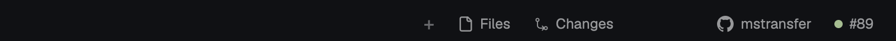

# herdr-github-link

A [Herdr](https://herdr.dev) mod: buttons at the right of the tab bar that
open the focused terminal's GitHub repo and its branch's pull request in your
browser.

## Install

1. Copy `mods/github-link` to `~/.config/herdr-app/mods/`.
2. Herdr's built-in layouts are read-only, so use a personal layout. If you
   don't have one, run
   `herdr-app do layout.clone '{"name":"main","as":"my-main"}'`.
3. In that layout, replace the `tabs` block with the row shown in
   [RECIPE.md](RECIPE.md#built-from).
4. Run `herdr-app check ~/.config/herdr-app/mods/github-link`.

Or point your agent at this repo: it follows Herdr's steps for installing
mods other people made.

Needs `git`, plus `gh` logged in for the PR button. It runs `git`, `gh` and
`open`/`xdg-open`, and reads nothing else.
