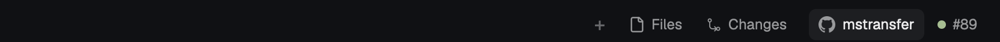

# GitHub Link

Two pills at the right end of Herdr's tab bar: the focused terminal's GitHub
repo, and the pull request for its current branch. Clicking either one
opens it in your default browser.



## What you see

A strip just right of the tab bar's own buttons (+, Files, Changes), on a
`chrome` background with a 1px `border` bottom line, so it looks like part of
the tab bar. The pills are 3px apart, with 10px right padding to match the
tab bar:

- **Repo pill**: the GitHub mark (14px, tinted) and the repo name (no owner;
  truncated at 160px).
- **PR pill** (only when the branch has a PR): a 7px dot and `#89`. The dot
  is `ansi2` (green) when open, `ansi5` (purple) when merged, and `dim` when
  closed or a draft.
- Pills are 26px tall, 8px side padding, radius 6, 12px text in `muted`.
  On hover they get a `hover` background and `foreground` text, like the
  shipped Files/Changes buttons. Hovering shows the full URL (and the PR
  state) as a tooltip.
- If the focused folder isn't a git repo, or its `origin` isn't on GitHub,
  the strip collapses to 0px.

## How it behaves

- It follows the **focused terminal**: `focused().cwd` and that pane's
  `branch` from `panes()`. Change pane, `cd`, or check out another branch
  and it updates.
- Clicking a pill opens its URL (`open` on macOS, `xdg-open` elsewhere).
- PR lookups are cached per repo and branch, and the cache is cleared every 2
  minutes so newly opened PRs show up. Repo lookups are cached per machine
  and folder.
- The block sizes itself to its pills. The pill row reports its width
  (`on_size_change`, divided by `settings().zoom`), and the mod runs
  `layout.resize {id, px: width + 10}` when the block's size differs by more
  than 1px. So the pills always sit right after Changes, and the
  block collapses when there's nothing to show.
- The window still drags from the padding. Pills stop the mouse-down so
  clicking them doesn't drag.

## Built from

- `mods/github-link/main.js`, `mod.json` (`"place": "none"`), `github.svg`.
- Repo: `exec("git", ["remote", "get-url", "origin"], { cwd, on: space.machine })`
  runs on the space's machine. The URL is parsed for `github.com[-alias]`
  remotes (https, `git@…:`, `ssh://`, ssh host aliases).
- PR: `exec("gh", ["pr", "list", "--repo", owner/repo, "--head", branch,
  "--state", "all", "--limit", "1", "--json", "number,url,state,isDraft"])`
  runs **locally**, with the person's own `gh` login, so remote machines
  don't need `gh`.
- Placement: the layout's `tabs` block becomes a row:

  ```json
  { "id": "tabs-row", "type": "row", "size": { "px": 42 }, "resizable": false, "children": [
    { "id": "tabs", "type": "block", "window_drag": true, "content": { "mod": "tabs" } },
    { "id": "github", "type": "block", "size": { "px": 0 }, "window_drag": true,
      "content": { "mod": "github-link", "props": { "block": "github" } } } ] }
  ```

  Herdr's shipped layouts are read-only, so do this in a personal layout
  (`herdr-app do layout.clone '{"name":"main","as":"my-main"}'`).
  `props.block` must match the block's `id`, because the mod resizes that node.

## Watch out

- Needs `git` (on the space's machine) and an authenticated `gh` (here).
  Without `gh`, the repo pill still works and the PR pill never shows.
- Only `origin` is used. Forks whose PRs live on `upstream` won't find them.
- GitHub only. GitLab and Bitbucket remotes show nothing.
- Very long repo names truncate at 160px.
- Don't pull the pills left with a negative margin to close the tab bar's
  10px right padding. The block clips them, which cuts off the first pill's
  hover background. The gap after Changes is 7px wider than Files→Changes
  for that reason.
- The size the mod picks is saved like a click in `layouts/.state/`. The
  layout file's `px: 0` is only the starting size.
- `"place": "none"` matters. Otherwise Herdr docks it as a separate bar the
  first time it sees the folder.

## Done when

- `herdr-app check mods/github-link` passes.
- Focusing a terminal in a GitHub repo shows the repo pill. On a branch with a
  PR, it also shows `#N` with the right state colour.
- Clicking each pill opens the right page in the default browser.
- In a non-git folder, the strip is empty and the window still drags from it.
